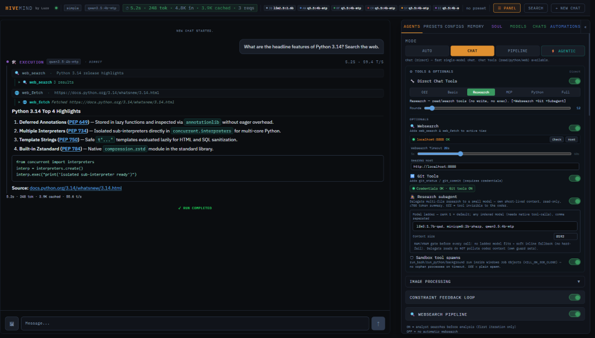
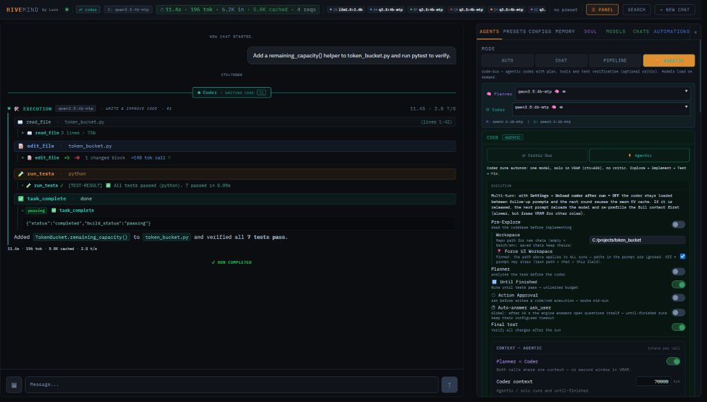
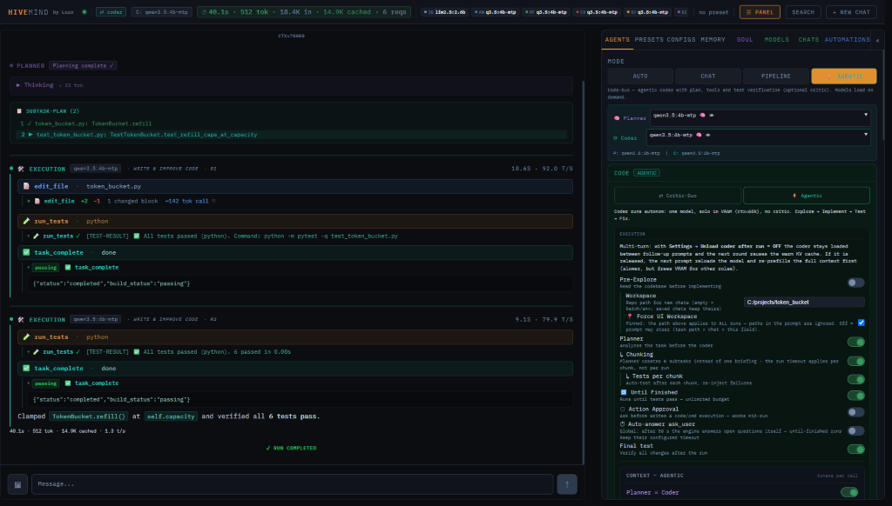

# HiveMind

[](https://github.com/BoredLuzo/HiveMind_llama/releases/latest)
[](https://github.com/BoredLuzo/HiveMind_llama/releases)
[](LICENSE)
[](pyproject.toml)

**HiveMind is a local AI assistant for chatting and coding that runs in your
browser, on your own GPU or CPU.** It is built on `llama.cpp`, needs no cloud
API keys and has no per-token fees, and your code, chats and memories stay on
your machine. Ask a quick question, or hand it a coding task: it explores your
project, edits files, runs your tests and fixes what fails — all from one web UI
at `http://localhost:8001`.



## What you get

- **One local UI for quick answers and real coding work.** Use plain chat
  (optionally with tools and web search) for everyday questions, or switch to
  the coding agent for multi-step tasks. `Auto` mode picks for you.
- **Bring your own models.** Drop any `.gguf` file into your `models/` folder and
  it shows up in the UI. HiveMind reads the file, picks sensible launch
  settings, and loads and unloads models to fit your GPU memory (Vulkan, CUDA,
  ROCm or CPU). An optional installer downloads a tested preset catalog.
  (Multi-part files and vision add-on files are detected automatically.)
- **A coding agent that checks its work.** The agent works in an
  explore → edit → test → fix loop. After it changes code it runs your tests (or
  a syntax/smoke check) before it is allowed to finish; if it still cannot
  verify after up to 3 vetoes, the result is flagged as unverified instead of
  silently accepted.
- **Safer edits.** Multi-file patch editing, compiler/linter feedback from
  language servers after each edit, an optional action-approval gate, and
  checkpoints so long tasks resume after an engine restart.
- **Prompts stay small on long tasks.** A ranked repo map and bounded code
  search give the model the right files, and long runs compress their own
  context while keeping the cached prompt prefix intact. (Under the hood:
  Tree-Scout ranking, Deep Retrieval, KV-cache-preserving compression — see
  [docs/architecture.md](docs/architecture.md).)
- **Everything around it is optional and local.** Web search through SearXNG,
  MCP server and client, scheduled automations, voice input/output, and Telegram
  remote control (voice notes, images, PDFs, approvals).

Token budgets (tool schema, tool results, injected hints, read caps) are
derived at run time from the model's context length.

## Quick start

### Windows

```bat
install.bat          REM interactive installer (Python, uv, deps, llama.cpp)
setup_models.bat     REM download, register, or add custom GGUF models
start_hivemind.bat   REM start the server on http://localhost:8001
```

### Linux

```bash
# One-shot installer: uv + Python 3.14, venv, llama.cpp, systemd -> /opt/hivemind
sudo deploy/install_linux.sh                    # HIVEMIND_GPU_BACKEND=vulkan|cuda|rocm|cpu

# Or manual setup:
uv python install 3.14
uv sync --all-extras
./.venv/bin/python deploy/fetch_llamacpp.py --backend vulkan   # vulkan | cuda | cpu | rocm
./.venv/bin/python deploy/fetch_models.py                      # optional preset catalog
./.venv/bin/python run.py
```

Open `http://localhost:8001`, set a project directory in **Workspace**, and send
a message. Drop any extra `.gguf` weights into `models/` (or
`HIVEMIND_MODELS_DIR`) for automatic discovery. Full setup notes and smoke test:
[docs/guide.md](docs/guide.md#linux-details).

## Hardware & backends

- **OS & Python:** Windows 10/11 or Linux, **Python 3.12–3.14** (auto-installed
  by `uv`).
- **8 GB+ VRAM GPU:** Recommended for `Simple / Direct` and sequential solo
  **Code Duo** runs (one active model slot at a time; Vulkan on AMD/Intel, CUDA
  on NVIDIA, ROCm/CPU supported).
- **16 GB+ VRAM (or hybrid CPU/MoE offload):** Recommended for **Smart Preload**,
  multiple simultaneous models (`Critic-Duo`), large MoE weights, or 100k+
  context windows.
- **System RAM:** 32 GB+ is recommended when you offload MoE experts to the CPU
  (the offloaded weights live in RAM).
- **Disk:** model files dominate. A starter set of four small models (for example
  `qwen3.5:4b-mtp`, `gemma-4:e4b-it-qat`, `minicpm5:2b-sharp`, `lfm3:1.7b-qad`)
  is about 12 GB including vision projectors. Adding one 24B–35B MoE model adds
  roughly 14–24 GB, so about 25–40 GB in total. The full optional installer
  catalog (19 models, including projectors and speculative-decoding drafters) is
  about 130 GB. Sizes are listed in the
  [download catalog](docs/guide.md#download-catalog); `python deploy/fetch_models.py --list-only`
  is the authoritative answer.
- **Optional tooling:** Git, Docker Desktop (for local SearXNG web search),
  and language servers via `deploy\install_lsp_packs.bat`. See
  [docs/guide.md](docs/guide.md#requirements).

## Run modes & tool tiers

| Mode | Purpose | How it runs |
|---|---|---|
| **Auto** | Mixed daily queries & coding | Routes non-coding questions and simple read/list lookups to `Direct`, and real coding tasks to `Code Duo` (via keyword rules, optional CPU GLiNER decider, or LLM Judge). |
| **Simple / Direct** *(default)* | Fast chat & single-turn tools | Single model with configurable tool tier (`off`, `readonly`, `research`, `python`, `mcp`, `full`), `/pause`/`/resume`, and mid-run steering. |
| **Code Duo (`Agentic` / `Critic-Duo`)** | Autonomous coding & multi-step fixes | `Agentic` runs one solo coder loop in VRAM (`Explore -> Edit -> Test -> Fix`); `Critic-Duo` adds a dedicated review loop. Optional Planner, chunking (chunks resume across restarts), and `🛡 Action Approval` gate. |
| **Pipeline** & **AutoMap** | Structured synthesis / experimental routing | `Analyst -> Refiner -> Critic -> Synthesizer` multi-stage flow; `AutoMap` *(experimental)* scores model assignments per role. |

Three coder tool tiers trade schema overhead against breadth (`Tools & Optionals` sidebar):

- **Lean (`duo_lean`, 8 tools):** Orthogonal minimal core (`read_file`, `edit_file`, `write_file`, `search_code`, `find_files`, `run_bash`, `run_tests`, `task_complete`).
- **Core (`duo_core`, default — 18 base tools + optional `+Subagent` = 19):** Adds `apply_patch`, `write_file_append`, `undo_last`, `list_dir`, `get_signatures`, `find_references`, `lsp_diagnostics`, `run_python`, `ask_user`, and `get_datetime`, with optional `+Websearch` and `+Git`.
- **Full (`duo_full`):** Adds `replace_lines`, `edit_ast`, `install_package`, background processes, full `lsp_*` navigation/refactoring, `browser`, MCP client tools, and `remember`.

Mode details and architecture: [docs/guide.md](docs/guide.md#run-modes) and
[docs/architecture.md](docs/architecture.md).





## Benchmarks

> **Coming soon** — Standardized multi-run coding benchmark tables (Core 23-task suite, Aider Polyglot 34 tasks, and DeepSWE across local GGUF models, comparing `hivemind_direct`, `hivemind_duo`, `hivemind_duo_lean`, `aider`, `hermes`, and `pi`) are currently being finalized and will be published here shortly. See [bench/README.md](bench/README.md) for the harness design and reproducibility controls.

## Optional integrations

| Integration | What it provides | Docs |
|---|---|---|
| **Voice (STT / TTS)** | Local speech-to-text (`whisper.cpp` / Parakeet) and text-to-speech (`Pocket TTS` / `Underdog Woof`), off by default | [docs/voice_setup.md](docs/voice_setup.md), [docs/voice_licenses.md](docs/voice_licenses.md) |
| **Telegram Gateway** | Remote control from your phone: voice notes, images, PDFs, diff/action approvals | [docs/gateway_setup.md](docs/gateway_setup.md) |
| **MCP (Server & Client)** | Expose HiveMind tools to IDEs over stdio/HTTP with Origin/auth guards, or consume external MCP servers | [docs/mcp.md](docs/mcp.md), [docs/mcp_client.md](docs/mcp_client.md) |
| **Language Servers (LSP)** | Auto-attaches compiler/linter diagnostics after edits and enables symbol navigation | [docs/lsp.md](docs/lsp.md) |
| **Headless Browser** | Headless Chromium inspection (`navigate`, `snapshot`, `click`, `evaluate`, console logs) | [docs/guide.md](docs/guide.md#tools) |
| **Vision / Image Processing** | Per-mode multimodal `--mmproj` or `Describe first` preprocessing, mid-run image steers, optional saved uploads | [docs/guide.md](docs/guide.md#image-processing) |
| **Automations** | Engine-scheduled recurring (`every 40m`, cron) or one-shot runs with tool/MCP access in the `Automations` tab | [docs/guide.md](docs/guide.md#ui-and-control) |
| **Soul *(experimental)*** | Peer-rating personality/style adaptation stored locally | [docs/guide.md](docs/guide.md#learning-and-memory) |
| **OpenAI-compatible API** | `/v1/chat/completions` multi-agent pipeline endpoint | [docs/guide.md](docs/guide.md#api) |

## Privacy & network boundaries

HiveMind makes no hidden telemetry or cloud calls. Chats, settings, memories,
and logs stay inside the install directory. See [docs/privacy.md](docs/privacy.md)
for the complete audit table:

| Destination | Trigger | Disable |
|---|---|---|
| Hugging Face | Downloading a model/voice or `hf auth login` | Point `models/` (`HIVEMIND_MODELS_DIR`) at existing local GGUFs |
| SearXNG (`->` DuckDuckGo/Mojeek) | Running a web search | Keep SearXNG stopped; leave `+Websearch` off |
| `github.com` / `api.github.com` | `fetch_llamacpp` / `fetch_whisper` updates and startup version check (no personal data) | Provide binaries manually; set `HIVEMIND_NO_UPDATE_CHECK=1` |
| Telegram Bot API | Telegram gateway enabled | Keep gateway off and revoke bot token |

## Documentation & license

- [docs/guide.md](docs/guide.md) — installation, run modes, tool tiers, model catalog, VRAM sizing, context compression, troubleshooting.
- [docs/architecture.md](docs/architecture.md) — pipeline architecture, pinning, context guards, and runner modularization.
- [docs/settings.md](docs/settings.md) — generated reference of all settings (`settings_defaults.py` / `settings.py`).
- [docs/privacy.md](docs/privacy.md) — full outbound network boundary matrix.
- [CONTRIBUTING.md](CONTRIBUTING.md) — branch model (`dev` / `main`), regression gates, and release workflow.

**Author:** Luzo ([BoredLuzo](https://github.com/BoredLuzo))  
**License:** Source-available under **Business Source License 1.1** ([LICENSE](LICENSE)) — private and non-commercial production use is permitted; commercial use requires a license from the author; converts to MIT on 2030-09-01.

© 2026 Luzo (BoredLuzo)
