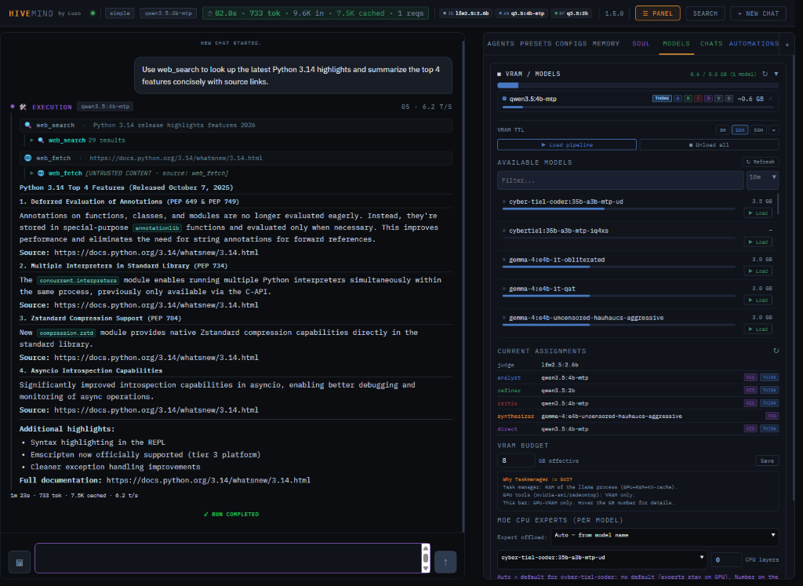
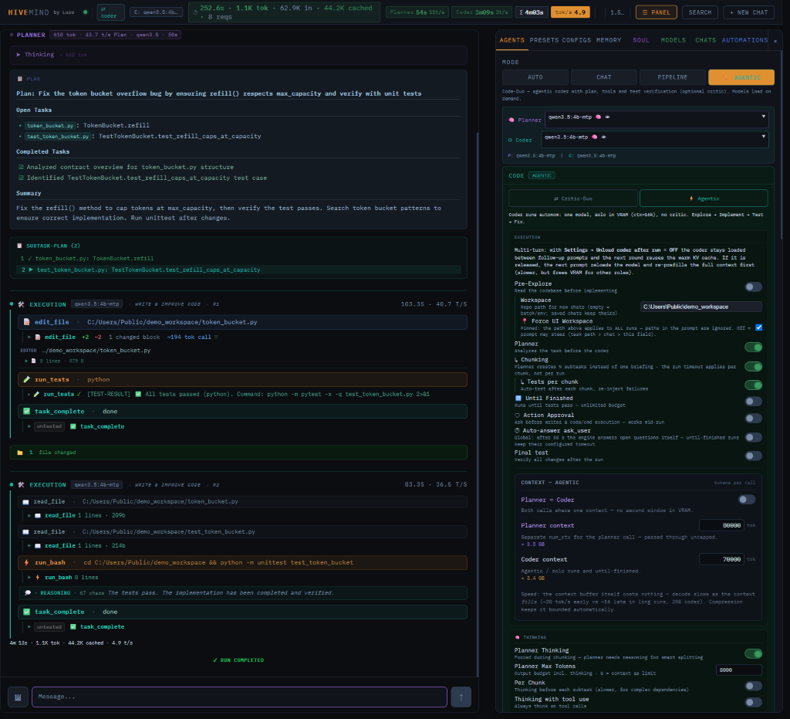

# HiveMind

[](https://github.com/BoredLuzo/HiveMind_llama/releases/latest)
[](https://github.com/BoredLuzo/HiveMind_llama/releases)
[](LICENSE)
[](pyproject.toml)

Local multi-agent coding assistant on top of llama.cpp. Several local LLM
"agents" (Analyst, Coder, Critic, Explorer, Judge, ...) run through structured
pipelines that analyze, plan and execute coding tasks, driven from a
single-page web UI at `http://localhost:8001` with live SSE streaming, a VRAM
monitor and full control over agents, models and run modes. Everything runs
on your own hardware: no cloud LLM, no API keys — your prompts, code and
answers are processed locally.

Author: Luzo (BoredLuzo) | https://github.com/BoredLuzo

**License:** source-available under **Business Source License 1.1** (see
[LICENSE](LICENSE)) — private, non-commercial production use is allowed;
commercial use needs a license from the author; no resale or hosted service.
HiveMind becomes MIT on 2030-09-01.



**What can leave the machine** — HiveMind makes no hidden calls. The full
table is in [docs/privacy.md](docs/privacy.md); the rows that matter most:

| Destination | Trigger | Switch it off |
|---|---|---|
| Hugging Face | you download a model or voice; one-time `hf auth login` for gated models | download nothing and point the model folder at files you already have |
| your SearXNG -> DuckDuckGo/Mojeek | a web search the agent (or you) runs | keep SearXNG down; use a tool profile without web search |
| github.com / api.github.com | install/update fetches llama.cpp and whisper.cpp binaries; the startup update check (no personal data) | use the release ZIP and place the binaries yourself; `HIVEMIND_NO_UPDATE_CHECK=1` |
| Telegram | gateway on: every message, answer, photo, voice note and file | gateway off (and revoke the bot token) |

Everything else stays on disk: settings, chats, memory and logs live in the
install folder. Fully offline: `HIVEMIND_NO_UPDATE_CHECK=1`, gateway off, no
MCP servers, SearXNG not running, a tool profile without web tools, and no
model/voice downloads — details in [docs/privacy.md](docs/privacy.md).

## Quick start

### Windows

```bat
install.bat          REM interactive installer (Python, uv, deps, llama.cpp)
setup_models.bat     REM download / register / add custom models
start_hivemind.bat   REM start the server
```

Open http://localhost:8001, set your project folder in the "Workspace" field,
send a message. There is no default workspace; the first run needs one.

### Linux

```bash
# one-shot installer: uv + Python 3.14, venv, llama.cpp, systemd -> /opt/hivemind
sudo deploy/install_linux.sh                    # HIVEMIND_GPU_BACKEND=vulkan|cuda|rocm|cpu

# or manually:
uv python install 3.14
uv sync --all-extras
./.venv/bin/python deploy/fetch_llamacpp.py --backend vulkan   # vulkan | cuda | cpu | rocm
./.venv/bin/python run.py
```

Then open http://localhost:8001 and set a workspace. Models go into the models
folder as GGUFs, or `./.venv/bin/python deploy/fetch_models.py`.

Environment variables, custom llama.cpp builds, backends, mlock, CPU-host
notes and the first-run smoke test:
[docs/guide.md](docs/guide.md#linux-details).

## Hardware

- Windows 10/11 or Linux.
- **Python 3.12–3.14** (Python 3.14 is auto-installed by the setup via `uv`).
- **8 GB+ VRAM GPU** recommended for single-model / **Code Duo** sequential runs
  (one active model slot at a time, e.g. 4B–9B or Q4 MoE models; AMD/Intel via
  Vulkan, NVIDIA via CUDA); **16 GB+ VRAM** (or CPU/hybrid offload) is
  recommended for **Smart Preload**, multiple simultaneously loaded models, or
  100k+ context runs. ~30 GB disk for the recommended model set.
- uv (auto-installed); Git (optional), Docker Desktop (optional, SearXNG web
  search), Windows Core Utils (recommended on Windows). Full list and notes:
  [docs/guide.md](docs/guide.md#requirements).

## Modes: Simple/Direct and Code Duo

These two are the reliable agentic paths; everything else is optional:

- **Simple / Direct** (default): a single model answers directly, with an
  optional tool tier up to full edit/exec (`direct_tools_tier`).
- **Code Duo**: Planner + Coder + Critic loop with tree-scout and static
  repo-map codebase analysis, chunking, auto-test, self-fix and an optional
  action-approval gate. Finished chunks are checkpointed, so an engine
  restart resumes at the next chunk.

Auto routing, AutoMap (experimental, learns from run outcomes) and the
multi-agent Pipeline are there when you want them — not needed for daily
work. Mode tables, tool tiers, approval gate and the Duo internals:
[docs/guide.md](docs/guide.md#run-modes). How the components fit together:
[docs/architecture.md](docs/architecture.md).



## Extras (all optional)

| Extra | What it does | Docs |
|---|---|---|
| Voice | local speech to text (whisper.cpp/Parakeet) and text to speech (Pocket TTS), off by default | [docs/voice_setup.md](docs/voice_setup.md), [docs/voice_licenses.md](docs/voice_licenses.md) |
| Telegram | run and steer HiveMind from your phone: voice notes, photos, PDFs, approvals | [docs/gateway_setup.md](docs/gateway_setup.md) |
| MCP | HiveMind's tools for your IDE (server) and external MCP servers as tools (client), both opt-in | [docs/mcp.md](docs/mcp.md), [docs/mcp_client.md](docs/mcp_client.md) |
| LSP | language servers already on the machine become diagnostics/definition/format tools (active once a server for the file type is installed) | [docs/lsp.md](docs/lsp.md) |
| Browser | headless Chromium tool for the agent (navigate, snapshot, click, ...) | [docs/guide.md](docs/guide.md#tools) |
| Soul *(experimental)* | peer-rating personality evolution injected into system prompts | [docs/guide.md](docs/guide.md#learning-and-memory) |
| Pipelines | Analyst -> Refiner -> Critic -> Synthesizer runs; OpenAI-compatible `/v1/chat/completions` endpoint | [docs/guide.md](docs/guide.md#api) |

## Documentation

- [docs/guide.md](docs/guide.md) — the full guide: requirements, installation
  (Windows/Linux), run modes and tool tiers, tools, LSP, MCP, VRAM & models,
  adding your own models and the download catalog, context compression, UI,
  voice, Telegram, memory, safety, API, configuration defaults, SearXNG,
  scripts, updating, deployment, testing, use cases, known limitations and
  troubleshooting.
- [docs/privacy.md](docs/privacy.md) — what can leave the machine, in full.
- [docs/architecture.md](docs/architecture.md) — how the components fit
  together and how context is built, pinned, guarded and compressed.
- [docs/settings.md](docs/settings.md) — the full generated settings list;
  source of truth `settings.py`.
- [CONTRIBUTING.md](CONTRIBUTING.md) — branches, pre-commit hook and release
  steps (belongs to the repository, not to the release zip).

Token budgets (tool schema, tool results, injected hints, read caps) are
derived at run time from the model's context length.

© 2026 Luzo (BoredLuzo)
